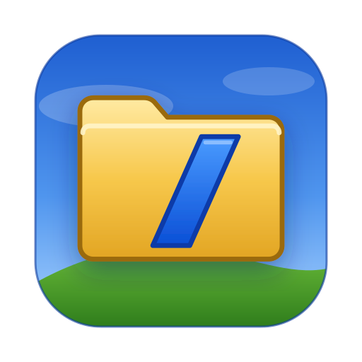
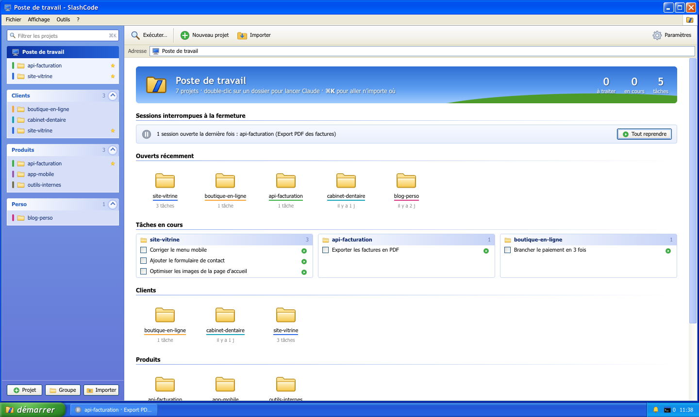
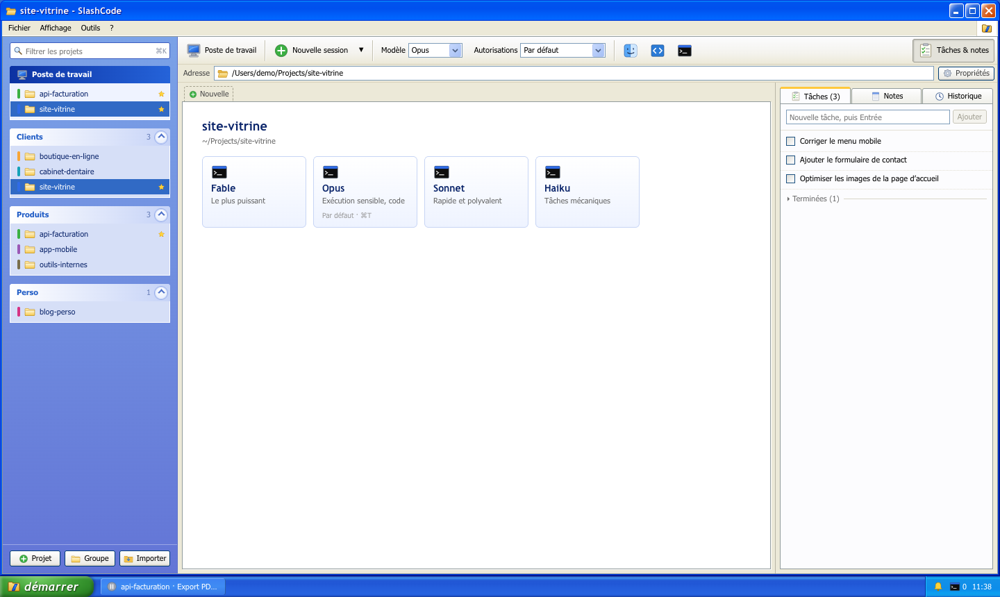

<p align="center"></p>

# SlashCode

Organisateur de sessions [Claude Code](https://claude.com/claude-code) pour Mac Apple Silicon, habillé de la tête aux pieds en Windows XP (Luna).

Quand on jongle avec cinq ou six projets et plusieurs sessions Claude dans chacun, les fenêtres de terminal se perdent. SlashCode range tout par **dossier de travail** : chaque projet garde ses sessions (de vrais terminaux), ses tâches, ses notes et l'historique de ses conversations Claude, et l'app prévient quand une session a besoin de toi.



## Ce qu'il fait

- **Projets rangés par groupes** repliables (Clients, Produits, Perso…), favoris, couleurs, archives. Glisser un projet d'un groupe à l'autre le déplace ; glisser un dossier du Finder sur un groupe crée un projet.
- **Import en un clic** : au premier lancement, SlashCode liste tous les dossiers où Claude Code a déjà servi (`~/.claude/projects`).
- **Sessions = vrais terminaux** (xterm.js + node-pty) qui lancent `claude` : toutes les fonctions du CLI restent disponibles. Les onglets survivent au changement de projet, et après un redémarrage « Tout reprendre » relance chaque conversation (`claude --resume`).
- **Choix du modèle en un clic** (Fable, Opus, Sonnet, Haiku), modèle et mode d'autorisation par défaut propres à chaque projet.
- **Écran partagé** : 1, 2, 3 ou 4 sessions du projet à l'écran (`⌥⌘1` … `⌥⌘4` ou les boutons de disposition). Chaque volet est une petite fenêtre avec sa barre de titre ; un clic lui donne le focus, et un onglet masqué choisi prend la place du volet actif.
- **Dictée** (`⌘D` ou le bouton micro) : tu parles, le texte s'affiche en direct, `↩` l'envoie à Claude, `⌘D` l'insère sans l'envoyer, et on peut le corriger avant. Reconnaissance vocale d'Apple sur le Mac (SpeechAnalyzer de macOS 26, sans Siri ni connexion), en français par défaut.
- **Mode sombre** façon Royale Noir, le thème noir de XP (Affichage > Mode sombre, ou Paramètres > Apparence : clair, sombre ou comme macOS).
- **Tâches** par projet : le bouton ▶ lance une tâche comme premier message d'une nouvelle session, ➤ l'écrit dans la session active.
- **Notes** par projet, enregistrées automatiquement, envoyables à la session active.
- **Historique** des conversations Claude du dossier, reprise en un clic.
- **GitHub** sans quitter l'app : un onglet GitHub (pour les dossiers reliés à un dépôt GitHub) liste les pull requests ouvertes avec leurs checks et l'état de la revue, et les derniers workflows GitHub Actions. Un run se déplie pour montrer ses jobs et les étapes en échec. Le bouton ➤ envoie à Claude la fin du log d'un run en échec, ou les commentaires de revue d'une PR (ou lui demande de la relire) : c'est tapé dans la session active, ou une nouvelle session démarre dessus. On peut aussi relancer les jobs en échec. Une pastille dans la barre latérale montre l'état de la CI, et une bulle prévient quand un run se termine. Tout passe par le client `gh` déjà connecté (`brew install gh`, puis `gh auth login`), sans jeton à saisir.
- **Notifications** quand Claude demande une autorisation ou a fini son tour : notification macOS, bulle XP, bouton de la barre des tâches qui clignote, badge du Dock, et en option sur iPhone.
- **Peu de clics** : double-clic sur un projet pour lancer Claude, `⌘K` pour aller n'importe où, `⌘⇧A` pour sauter à la prochaine session qui attend.



## Installation

Prérequis : macOS sur Apple Silicon, Node.js 22 ou plus, et le CLI [Claude Code](https://docs.claude.com/en/docs/claude-code) installé (`claude` dans le PATH).

```sh
git clone https://github.com/ArchSeraphin/slashcode.git
cd slashcode
npm install
npm run dist                                                # construit dist/mac-arm64/SlashCode.app
codesign --force --deep -s - dist/mac-arm64/SlashCode.app   # signature locale
cp -R dist/mac-arm64/SlashCode.app /Applications/
```

Avec npm 11, les scripts d'installation sont bloqués par défaut : `package.json` autorise déjà ceux d'`electron` et de `node-pty`. node-pty utilise ses binaires précompilés (N-API), aucune compilation native n'est nécessaire.

Pour développer : `npm run dev` (rechargement à chaud) et `npm run typecheck`.

## Raccourcis

| Raccourci | Action |
|---|---|
| `⌘K` | Exécuter… : aller à un projet ou une session (`⌘↩` ouvre et lance une session) |
| `⌘T` | Nouvelle session dans le projet ouvert |
| `⌘W` | Fermer la session active |
| `⌘⇧A` | Prochaine session qui attend |
| `⌘⇧[` / `⌘⇧]` | Session précédente / suivante |
| `⌘1` … `⌘9` | N-ième onglet du projet |
| `⌘J` | Afficher ou masquer Tâches & notes |
| `⇧↩` | Nouvelle ligne dans le prompt Claude |
| `⌥⌘1` … `⌥⌘4` | Afficher 1, 2, 3 ou 4 sessions à l'écran |
| `⌘D` | Dicter un prompt (`⌘D` à nouveau pour l'insérer) |

## Comment marchent les notifications

À chaque session, SlashCode passe à `claude` des hooks via `--settings` (`SessionStart`, `UserPromptSubmit`, `PreToolUse`, `PostToolUse`, `Notification`, `Stop`). Chaque hook envoie un petit `curl` vers un serveur local de l'app, protégé par un jeton aléatoire. Ta configuration Claude n'est jamais modifiée.

Le contenu dit ce qui se passe : pour une autorisation, l'outil et la commande ou le fichier visé ; pour une fin de tour, le début de la réponse de Claude, le modèle et la durée.

Fermer la fenêtre avec des sessions en cours propose de les garder en arrière-plan : les notifications continuent d'arriver.

## Comment marche l'onglet GitHub

SlashCode lit le remote GitHub du dossier (`git remote -v`) puis interroge GitHub avec `gh pr list` et `gh run list`. Seuls les projets en cours d'usage sont suivis : celui qui est à l'écran (toutes les minutes, toutes les 10 s pendant un run) et ceux qui ont une session ouverte (toutes les 3 min, toutes les 20 s pendant un run). On reste très loin du quota de l'API GitHub. La bulle de fin de run se coupe dans Paramètres > Notifications.

## Dictée

Le module `src/native/dictate.swift` est compilé par `npm run build` (il faut les outils Xcode, `swiftc`) en un petit bundle `SlashCodeDictee.app`, lancé par SlashCode le temps d'une dictée. Il se déclare responsable de ses propres autorisations : à la première dictée, macOS demande l'accès au micro (et, avant macOS 26, à la reconnaissance vocale) pour « SlashCode Dictée ». Sur macOS 26 et plus, le modèle de langue est téléchargé une seule fois, puis tout se passe sur le Mac. La langue se règle dans Paramètres > Dictée.

### Sur l'iPhone

Deux services au choix dans Paramètres > Sur l'iPhone :

- **[Bark](https://apps.apple.com/app/id1403753865)** (recommandé) : icône SlashCode sur chaque notification, regroupement par projet, demandes d'autorisation « urgentes » qui passent le mode Concentration. Le serveur officiel `https://api.day.app` fonctionne directement ; pour plus de confidentialité, héberge le tien avec [`deploy/bark/docker-compose.yml`](deploy/bark/docker-compose.yml) derrière un proxy HTTPS. Colle ensuite l'adresse donnée par l'app Bark dans « Clé de l'appareil ».
- **[ntfy](https://ntfy.sh)** : sans compte, mais pas d'icône personnalisée sur iPhone.

Par défaut, l'iPhone n'est prévenu que si tu n'es pas devant le Mac (écran verrouillé ou aucune activité depuis 2 minutes).

## Pile technique

Electron, React, xterm.js, node-pty, electron-vite. Thème Luna écrit à la main (aucun élément graphique Microsoft) ; icônes dessinées en SVG. Les données sont dans `~/Library/Application Support/SlashCode/slashcode-data.json`. `SLASHCODE_USERDATA=/un/dossier` lance l'app sur un autre jeu de données (tests).

## Logo

Piste « Dossier-slash » : le dossier jaune de l'époque, la commande `/` taillée dedans. Sources dans [`design/logo/final/`](design/logo/final) : icône d'app, coupe petite taille (16–32 px), versions noire, blanche et monochrome, icônes de notification.

## Licence

SlashCode est publié sous [PolyForm Noncommercial 1.0.0](LICENSE.md) :

- **Autorisé gratuitement** : usage personnel, études, recherche, associations, organismes publics ; lire, modifier et partager le code, à condition de garder la licence et la mention de copyright.
- **Interdit sans accord** : tout usage commercial (utilisation dans une entreprise à but lucratif, revente, intégration dans un produit ou un service payant).

**Usage commercial : licence sur demande.** Ouvre une [issue](https://github.com/ArchSeraphin/slashcode/issues) ou contacte [@ArchSeraphin](https://github.com/ArchSeraphin) sur GitHub.

Les dépendances (Electron, React, xterm.js, node-pty…) gardent leurs propres licences, MIT pour la plupart.

SlashCode n'est affilié ni à Anthropic ni à Microsoft. Windows XP est une marque de Microsoft.
